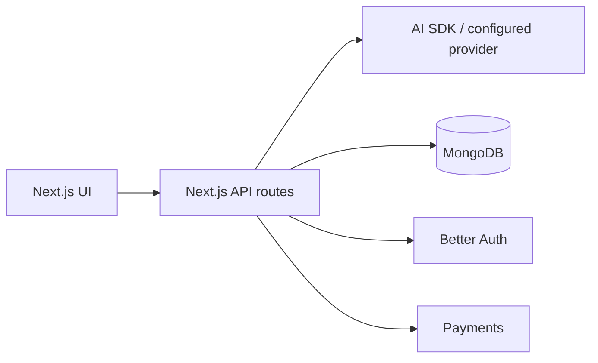
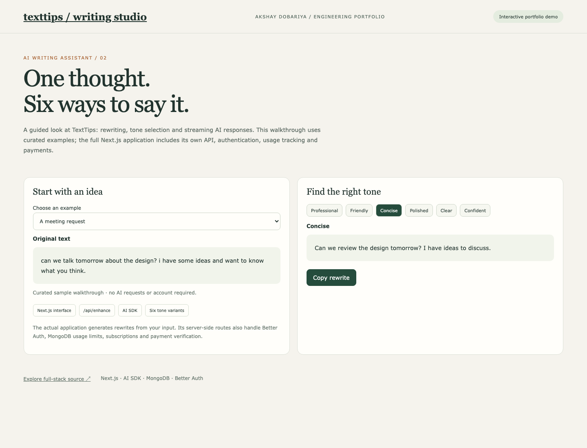

# TextTips — Full-stack AI Writing Assistant

Despite the `fe-` repository name, this is a **full-stack Next.js application**. A separate backend repository is not required.

## What is implemented

- Writing interface with six tones: Professional, Friendly, Concise, Polished, Clear and Confident.
- Server-side AI integration in `src/app/api/enhance/route.ts` and `src/lib/ai/provider.ts`.
- Better Auth authentication, MongoDB persistence, usage tracking and subscription records.
- Payment order and verification routes for Razorpay, alongside Stripe integration code.



## Credential-free portfolio walkthrough

```sh
node scripts/serve-portfolio.mjs
```

Open `http://127.0.0.1:4175`. Choose a curated writing example, switch between six tones and copy a rewrite. This is explicitly a **curated walkthrough**, not a live AI service. No account, payment or model key is required. Static files are in `public/portfolio`.



## Full application

Use Node.js 20+ and pnpm 10+.

```sh
pnpm install
cp .env.example .env
pnpm dev
```

Configure MongoDB, a strong Better Auth secret, and the AI provider. The existing enhance route currently checks `GEMINI_API_KEY` even when another provider is selected; configure Gemini for the unchanged flow. Authentication, email and billing need their corresponding credentials when used. See `src/config/index.ts` for the full environment configuration. Deployment workflows are manual and require your own runner setup.
